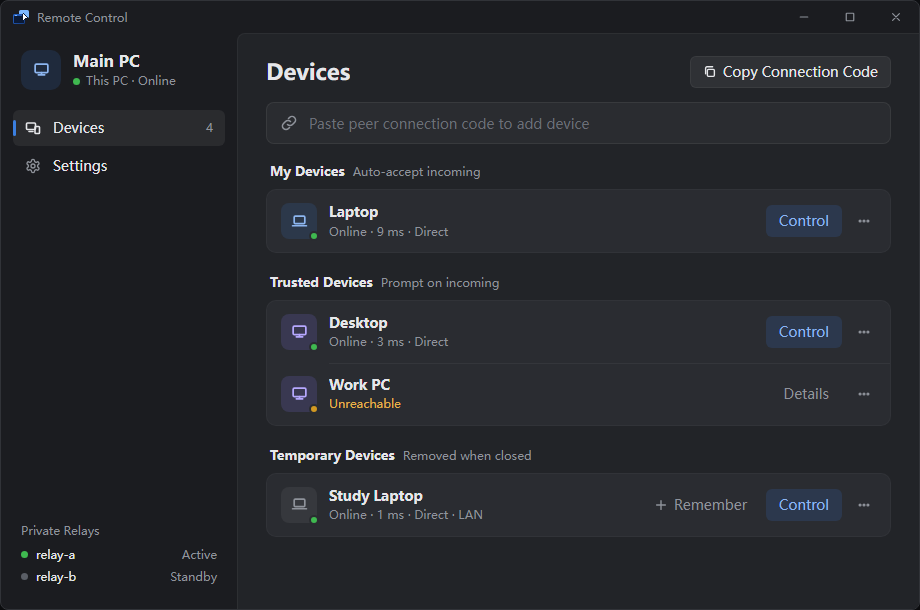
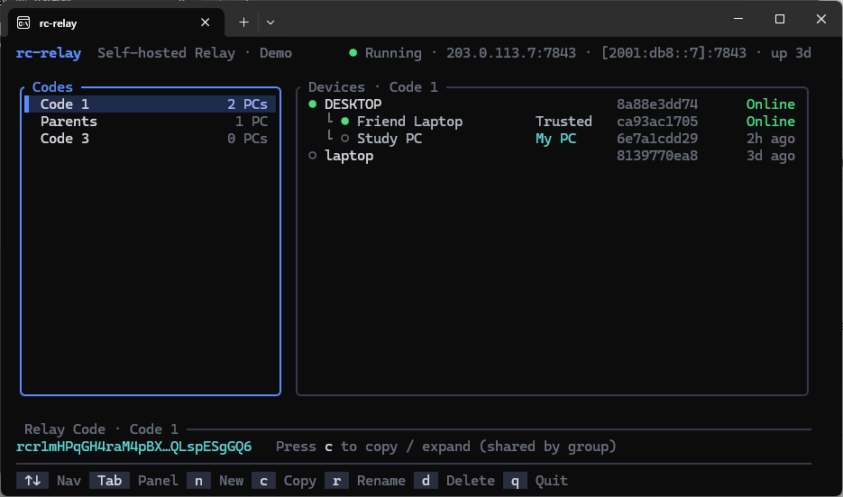

<div align="center">
  
  <h1>REMOTE CONTROL</h1>
  <p><a href="README.md">简体中文</a> · <strong>English</strong></p>
  <p><strong>Single-exe, P2P-first Windows remote desktop, terminal &amp; AI Agent cross-device control tool</strong></p>
  <p>
    Built with Rust &amp; iroh. No accounts, direct hole-punching by default;<br />
    Integrates with <strong>Claude Code / Codex</strong> to run commands and transfer files across PCs, with optional Docker relay for restricted networks.
  </p>
  <p>
    <a href="https://peteroooooooo.github.io/remote-control/?lang=en"><strong>Try Online Demo →</strong></a> (Interactive web preview)
  </p>
  
</div>

---

## Key Features

- **Cross-Device Control for AI Agents**: One-click Skill install (`~/.claude/skills`, `~/.agents/skills`) lets Claude Code and Codex call `devices`, `exec`, and `cp` on your other Windows PCs, reusing the lobby's connections and device permissions.
- **Remote Desktop**: GPU hardware encoding/decoding and DXGI rendering (up to 144 fps, 4:4:4 crisp text mode, FEC packet-loss recovery); supports multi-monitor switching, clipboard sync (text, images, files, folders), `Ctrl+Alt+Del`, and lock-screen control.
- **Remote Audio**: Supports Opus and lossless 24-bit PCM modes with independent volume control and one-click remote speaker mute.
- **Remote Terminal & File Transfer**: Drop straight into remote PowerShell, run commands, or transfer files/folders via CLI without starting a desktop stream.
- **Private Relay (Optional)**: Single Docker image with built-in self-signed TLS, no domain required, forwarding end-to-end encrypted traffic exclusively for your devices.

---

## Comparison

|                         | Remote Control                                                                   | RustDesk                                                                     | ToDesk / Sunlogin                                   |
| ----------------------- | -------------------------------------------------------------------------------- | ---------------------------------------------------------------------------- | --------------------------------------------------- |
| **AI Agent / CLI**      | Native `devices` / `shell` / `exec` / `cp` and Skill                             | No built-in remote shell / AI Skill                                          | No built-in remote shell / AI Skill                 |
| **Account**             | None; local keys + connection codes                                              | None; ID + password                                                          | Account required for controller / unattended access |
| **Distribution**        | Single portable `.exe` (optional background service)                             | Installer / portable (optional background service)                           | Installer / portable                                |
| **Connection & Relay**  | Direct P2P first; public nodes never relay video; self-host relay if P2P fails   | Direct P2P first; falls back to free public relays or self-hosted `hbbs+hbbr` | Vendor-routed relays; free tier has limits          |
| **Platform**            | Windows 10/11 only                                                               | Cross-platform (desktop + mobile)                                            | Cross-platform (desktop + mobile)                   |

---

## Network Connectivity

| Network Environment                                  | Connection Method                   |
| ---------------------------------------------------- | ----------------------------------- |
| Same LAN / Wi-Fi                                     | Direct LAN (1–5 ms)                 |
| Both ends have IPv6                                  | Direct IPv6                         |
| Either end has a public IP                           | Direct                              |
| Home broadband ↔ Home broadband                      | Direct NAT hole-punching            |
| EasyTier / Tailscale / virtual LAN                   | Direct over virtual adapter         |
| Both ends on strict corporate / campus symmetric NAT | **Requires private relay**          |
| Firewall blocks all UDP                              | **Requires private relay** (via TCP) |

- **Public Relay Assist**: Uses free public iroh nodes solely to exchange addresses for hole-punching — **never forwards screen video or input** (can be disabled in **Settings → Network & Discovery → Public Relay Assist**).
- **Private Relay**: Forwards end-to-end encrypted traffic only when direct P2P fails. Try enabling IPv6 on your router first before deploying a relay.

---

## Quick Start

### 1. Remote Desktop

Run `remote-control.exe` on both PCs:

- **LAN**: Click **Control** under **Temporary Devices** and wait for the other side to accept.
- **Across Networks**: Have the other side click **Copy Connection Code** and paste it into the top input bar (or press `Ctrl+V`). Codes are single-use and valid for 1 hour.
- **Frequent Devices**: Click **Remember** on a temporary device to add each other as **Trusted Devices**; set a device as **My Devices** in the `···` menu for prompt-free connections on double-click.

### 2. Background Service

Enable via **Settings → Background Service → Install** (requires administrator privileges):

- Enables auto-start at boot, background presence after closing the window, and control across the lock screen, sign-in screen, and UAC prompts (lock-screen control applies only to **My Devices**).
- Runs the current `.exe` directly and stores keys/config in `%APPDATA%\remote-control`. Right-click the tray icon → **Exit** to stop the service and go offline.

### 3. AI Agent & CLI

Install via **Settings → AI Integration → AI Skills → Install** on the controller PC so Claude Code / Codex can run commands and transfer files across devices (**My Devices** run without prompts, **Trusted Devices** prompt once, and commands run elevated when the target has the background service installed).

```powershell
remote-control devices                          # List online devices
remote-control shell laptop                     # Interactive remote PowerShell
remote-control exec laptop "git status"         # Run a remote command
remote-control exec laptop --cwd D:\proj "git status"
remote-control cp .\report.pdf laptop:Desktop   # Upload file/folder (reverse args to download)
```

All commands (`remote-control <command> --help` shows each one's options):

| Command | What it does |
|---|---|
| `remote-control` | Open the lobby window (no command) |
| `devices` | List devices and whether they are online |
| `shell <device>` | Interactive remote PowerShell |
| `exec <device> "<command>"` | Run one command remotely and return its output |
| `cp <from> <to>` | Copy files or folders; write the remote side as `device:path` |
| `set <setting> <value> …` | Change settings, see [section 5](#5-command-line-setup--batch-deployment) |
| `install-service` / `uninstall-service` | Install / remove the background service (admin) |
| `service-status` | Show whether the background service is running |
| `update` | Check for and install a new version |
| `id` | Show this device's ID |
| `host` | Stay online without the window, waiting to be connected to |

### 4. Deploy a Private Relay (Optional)

```yaml
services:
  rc-relay:
    image: ghcr.io/peteroooooooo/rc-relay:latest
    container_name: rc-relay
    restart: unless-stopped
    network_mode: host
    volumes:
      - rc-relay:/var/lib/rc-relay

volumes:
  rc-relay:
```

1. Open `7843/TCP` and `7842/UDP` in your server firewall and cloud security group.
2. Copy the relay code from `docker logs rc-relay` or `docker exec -it rc-relay ui` and paste it into **Settings → Private Relays** on each PC.
3. Run `docker exec -it rc-relay ui` to open the terminal UI for managing groups and online devices:

   

See [apps/rc-relay/README.en.md](apps/rc-relay/README.en.md) for custom domains, TLS certificates, and advanced options.

### 5. Command-Line Setup & Batch Deployment

`remote-control set` changes the Settings page's options, for `.bat` files and deployment tools:

```powershell
remote-control set relay rcr1… public off host-only on   # Join a private relay, turn off public assist, host only
remote-control install-service                           # Install the background service (admin)
```

| Setting | Value | In the window |
|---|---|---|
| `relay` | relay code `rcr1…` | Private Relays |
| `public` | `on` / `off` | Public Relay Assist |
| `lan` | `on` / `off` | LAN Discovery |
| `name` | a name; `""` for the computer name | Device Name |
| `language` | `auto` / `zh` / `en` | Language |
| `boot` | `on` / `off` | Start with Windows (background service) |
| `lock` | `on` / `off` | Allow Lock Screen Control (background service) |
| `awake` | `on` / `off` | Keep Awake on AC Power (background service) |
| `host-only` | `on` / `off` | Host Only (not in the window; command line only) |

- Every PC can use the same relay code; the relay lists each one separately. Add `name Finance-01` when computer names are hard to tell apart.
- Only the settings given change; a running lobby or service applies them at once. If any value is wrong, nothing changes and the exit code is non-zero.
- Settings belong to the Windows user who runs the command, so run it as the user who uses the PC.
- See `remote-control set --help` for every setting. **Host Only** hides pasting codes, Control, Terminal and AI Integration. It is set from the command line only, not in Settings; turn it off with `remote-control set host-only off`.

To deploy to many PCs, put this `deploy.bat` next to `remote-control.exe` (a zip is easiest to send), fill in your relay code, and have each PC double-click `deploy.bat`:

```bat
@echo off
"%~dp0remote-control.exe" set relay rcr1… public off host-only on
"%~dp0remote-control.exe" install-service
pause
```

- `%~dp0` is the folder the `.bat` is in, so it finds the exe wherever the zip is extracted.
- The second line installs the background service (reachable on the lock and login screens and UAC prompts). It needs **Run as administrator**, from the account that normally uses the PC. Without the service, delete that line and just double-click.
