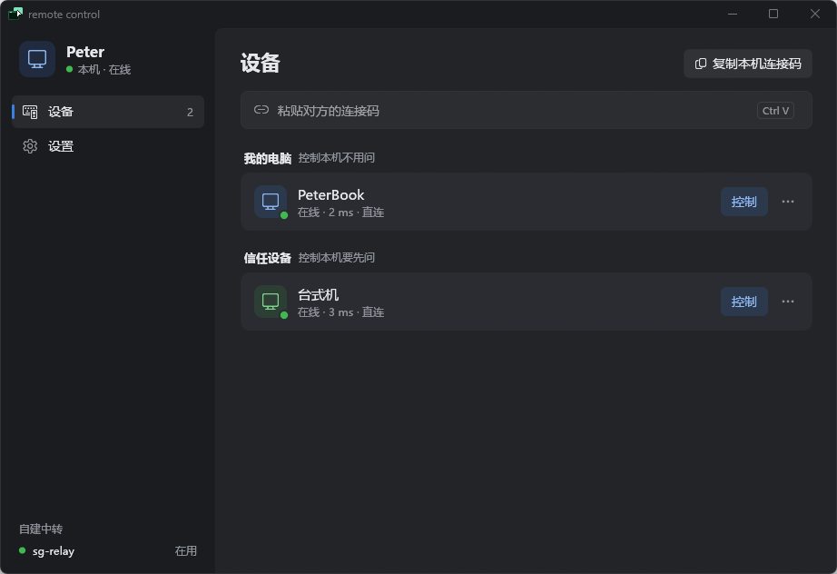
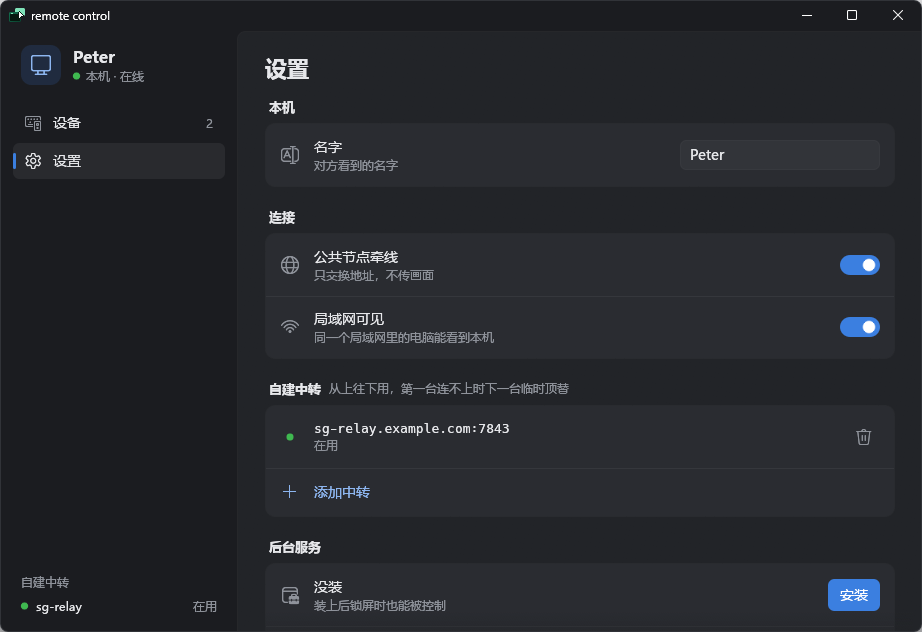
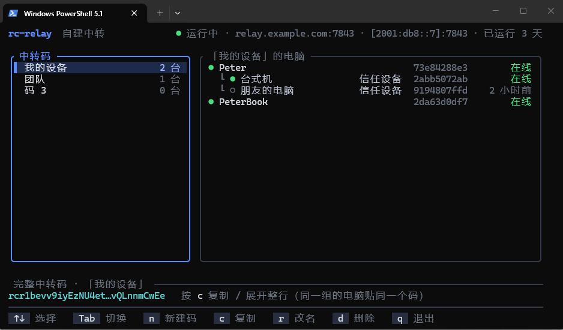

# remote-control

一个单文件、点对点（P2P）优先的 Windows 远程桌面与远程终端工具，基于 Rust 和 iroh（QUIC）构建。

不用注册账号，下载 `remote-control.exe` 直接运行，就能远程看屏幕、操作键鼠、传文件、跑命令。画面优先走两台电脑之间的直连，不经过第三方服务器；网络实在打不通时，可以用 Docker 部署一个**只给自己用的私有中转**。

**[在线试一试 →](https://peteroooooooo.github.io/remote-control/)**（网页模拟的主界面，可以点控制、开终端、贴连接码，数据都是假的）

| 设备 | 设置 |
| --- | --- |
|  |  |

---

## 核心功能

- **远程桌面**：同一局域网自动发现设备，跨网络用「连接码」连接；支持多显示器切换、剪贴板同步、`Ctrl+Alt+Del`，装上后台服务后锁屏状态也能控制。
- **远程终端与文件传输**：不开画面，直接在命令行里用对方电脑的 PowerShell、执行命令、互传文件。
- **AI 远程操作**：一键给 Claude Code / Codex 装上 Skill，让 AI 直接操作你的其它电脑。
- **私有中转（可选）**：一个 Docker 镜像，只转发你自己设备的流量，不需要域名和证书。

---

## 与 RustDesk、ToDesk 等软件对比

| | remote-control | RustDesk | ToDesk / 向日葵 |
| --- | --- | --- | --- |
| **账号** | 不需要，靠本地密钥和连接码 | 不需要，ID + 密码 | 通常需要注册登录 |
| **安装** | 单个 exe，控制端被控端一体 | 安装包 / 便携版 | 需安装客户端和后台服务 |
| **画面经过谁的服务器** | 默认直连，公共节点不转画面 | 打不通时走公共中转，高峰易卡 | 走厂商服务器，免费版限速限画质 |
| **自建中转** | 单镜像，自带证书，只转自己设备 | 需部署 `hbbs` + `hbbr`，自己管 key | 不支持 |
| **命令行 / AI 操作** | 内置 `shell` / `exec` / `cp` 和 AI Skill | 无 | 无 |
| **平台与声音** | 仅 Windows 10/11，暂无声音 | 全平台，有声音 | 全平台，有声音 |

**适合**：主要用 Windows、想要免账号的轻量工具、不想让画面经过别人的服务器、想用命令行或 AI 操作其它电脑。

**不适合**：需要用手机 / Mac 控制，或者需要远程声音。

---

## 快速上手

### 1. 远程控制桌面

两台电脑都运行 `remote-control.exe`，打开主界面：

- **同一局域网**：对方会出现在「临时设备」里，点 **「控制」**，对方点「允许」后开始。
- **跨网络**：对方点 **「复制本机连接码」** 发给你，你把连接码粘贴到主界面顶部的输入框，或者在窗口里直接 `Ctrl+V`。连接码 1 小时内有效，只能用一次。
- **以后还要连**：在临时设备上点 **「记住」**，对方同意后两边互相成为信任设备，关掉软件、换了网络也能找到对方。
- **自己的电脑**：在信任设备右侧的 `···` 菜单里选 **「我的电脑」**，它控制本机时就不用问了，双击设备直接连。

临时设备只在两边窗口都开着时存在，所以第一次连某台电脑时，两边都要把窗口打开。

### 2. 后台服务与托盘

**「设置 → 后台服务 → 安装」**（需要管理员权限）。装好后：

- 关掉窗口也保持在线，开机自动在线；
- 锁屏、登录界面和 UAC 弹窗下照常能被控制（「锁屏时可被控制」只对我的电脑开放）。

另外几点：

- **托盘**：关掉窗口后，程序留在任务栏右下角的托盘里（Windows 11 默认收在 `^` 里，可以拖到任务栏上常驻）。单击图标打开窗口；右键「退出」会让这台电脑下线，并停掉后台服务。
- **文件在哪**：后台服务直接运行你打开的这个 exe，不复制到别处；设备密钥、设备列表和设置都在 `%APPDATA%\remote-control`。
- **换新版本**：先在托盘右键「退出」，再替换 exe，重新打开时服务会跟着启动。exe 换了位置的话，主界面会提示「改用这个」，点一下即可。

### 3. 远程终端与文件传输

```powershell
remote-control shell laptop                  # 进入 laptop 的 PowerShell
remote-control exec laptop "git status"      # 在 laptop 上执行一条命令
remote-control cp .\report.pdf laptop:Desktop  # 传文件（反过来写就是取回）
```

更多用法见 `remote-control --help`。

### 4. 让 Claude Code / Codex 操作你的其它电脑

**「设置 → AI → 写入」**，会把 `remote-control` 的 Skill 写进本机 Claude Code（`~/.claude/skills`）和 Codex（`~/.agents/skills`）。之后直接跟 AI 说「去笔记本上看看日志」「把这个文件拷到台式机」，它就会自己调用上面的命令完成。

### 5. 部署私有中转（可选）

两端都在严格的公司或校园网、或者网络屏蔽了 UDP，直连打不通时才需要（主界面会提示「找不到直连」）。

**它怎么工作：**

- 中转启动时生成一个**中转码**，你的每台电脑都贴这同一个码，就成了这台中转的成员。
- 贴了同一个码的电脑之间互相转发；每台电脑的信任设备、我的电脑和临时设备，只能经中转连到这台电脑本身。别人就算连上中转，也什么都转不了。
- 中转只能看到加密后的字节，看不到画面、键鼠和命令内容。
- 在中转的管理界面里删掉某台设备，1 秒内生效：带它进来的那台电脑也会把它删掉。

**部署：** 在 Portainer、1Panel 等面板新建 Stack，粘贴：

```yaml
services:
  rc-relay:
    image: ghcr.io/peteroooooooo/rc-relay:latest
    container_name: rc-relay
    restart: unless-stopped
    network_mode: host
    volumes:
      - rc-relay:/var/lib/rc-relay

volumes:
  rc-relay:
```

1. 服务器防火墙和云厂商安全组放行 `7843/TCP` 和 `7842/UDP`。
2. 启动后从 `docker logs rc-relay` 复制中转码。
3. 在你的每台电脑上，把它贴到 **「设置 → 自建中转」**。
4. 想分组、看谁在线或删掉某台设备，在容器控制台执行 `rc-relay`，进入终端管理界面：

   

**地址和证书：** 默认不需要域名和证书。中转自己生成一张证书，指纹写在中转码里，软件按指纹认它。中转码里装的是服务器的 IP，所以**服务器 IP 变了，每台电脑都要重新贴码**；IP 会变的话（家里的宽带、没绑固定 IP 的云服务器），给它配一个域名。只有 IPv4 或 IPv6、域名、正式证书、家里的机器等各种情况，见 [apps/rc-relay/README.md](apps/rc-relay/README.md)。

**加了几台中转时：**

- 设备名单和连接码会同步到每一台；在任何一台上删掉的设备，其他中转也会随之去掉。
- 画面只走排第一的那台。点某行的「使用」可以把它换到第一；新贴的中转码自动排第一。
- 第一台连不上 10 秒后，下一台能连上的临时顶替；第一台恢复后自动换回来。

---

## 网络连通能力

连接时会同时尝试所有可能的路线（局域网、IPv6、公网打洞、虚拟局域网），哪条通、哪条快就用哪条。

| 网络环境 | 结果 | 需要中转 |
| --- | --- | --- |
| 同一局域网 / Wi-Fi | 局域网直连，延迟 1~5ms | 否 |
| 两端都有 IPv6 | IPv6 直连 | 否 |
| 普通家用宽带 ↔ 普通家用宽带 | 打洞直连 | 否 |
| EasyTier / Tailscale 等虚拟局域网 | 通过虚拟网卡直连 | 否 |
| 一端有公网 IP | 直连 | 否 |
| 两端都在严格的公司 / 校园网（对称 NAT） | 走自建中转 | 是 |
| 防火墙屏蔽所有 UDP | 走自建中转（TCP） | 是 |

连接过程：先通过公共节点或中转快速连上（几百毫秒），后台同时打洞，通常 1~1.5 秒内自动切到直连，画面不中断。连上后持续测延迟和丢包，直连变差时自动切回中转，并在后台继续尝试直连；断线 6 秒内会明确提示，不会卡死在旧画面上。

公共节点只负责帮两端交换地址，不转发画面。
