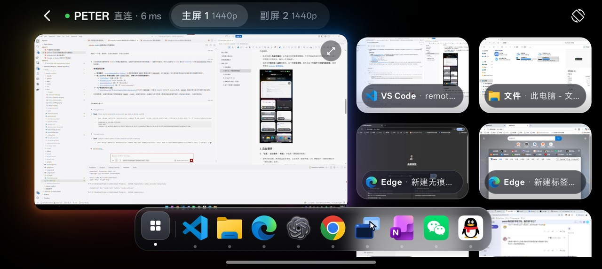

# Android 控制端使用指南

<strong>简体中文</strong> · <a href="android.en.md">English</a>

用 Android 手机或平板控制 Windows 电脑。电脑端照常运行 `remote-control.exe`，手机只做主控，不能被控。

- 安装：从 [GitHub Releases](https://github.com/Peteroooooooo/remote-control/releases) 或 [CNB](https://cnb.cool/peteroooooooo/remote-control/-/releases) 下载最新 `remote-control.apk`。要求 Android 10 及以上、64 位（arm64）。
- 更新：右上角齿轮 →「检查更新」。只在你点的时候检查，不会自己弹提示。部分系统（如 ColorOS）安装时会弹风险提示并要求输入锁屏密码，这是系统行为。

---

## 1. 连接电脑

- **同一局域网**：电脑会自动出现在「可用电脑」里，点一下就连。电脑端会弹窗问是否允许。
- **跨网络**：电脑上点「复制本机连接码」，发到手机上；手机点右上角 **+**，粘贴 `rc1…` 连接码后点「添加」。
- **自建中转**：同样点 **+**，粘贴 `rcr1…` 中转码。之后同一中转下的电脑都能连。
- **记住**：点设备卡片上的「记住」，电脑端同意后互相保存。以后电脑只要在线（关掉大厅窗口也行，需后台服务），点开就能连。点卡片上的 `···` 可以重新检测连接或忘记设备。
- **设备名称**：齿轮 →「设备名称」，改的是电脑上看到的这台手机的名字，留空用手机型号。

## 2. 连上之后

连上先进入电脑主页（导播台）：顶部显示设备名与连接状态（`直连 / 中转 · 延迟`），下方是实时桌面预览和电脑上正在运行的窗口。

- 点桌面预览：全屏控制整个桌面。
- 单击窗口卡片：把该窗口切到前台并在桌面预览中查看；再次点击（或双击）直接全屏进入。
- 全屏里系统返回手势回到主页；在主页再返回一次会提示，再滑一次断开并回到电脑列表。

  

## 3. 全屏顶部的胶囊

| 按钮 | 作用 |
|---|---|
| ← | 回到主页 |
| 触控板 / 直触 | 切换两种触控模式（见下文） |
| `1.0×` | 当前缩放倍数，放大后出现，点一下恢复原大小 |
| ⌨ | 打开顶部输入框、快捷键栏和手机键盘 |
| ⟳ | 切换横竖屏 |
| `…` | 连接信息（延迟、帧率、直连/中转）、画质（分辨率 / 帧率 / 码率上限）、「只走中转」、「显示帧率与延迟」（左上角常驻小角标） |

## 4. 触控板模式

手机屏幕当笔记本触控板用，画面上有一个鼠标光标。适合精细点选、拖动窗口。

| 手势 | 效果 |
|---|---|
| 单指滑动 | 移动光标，快速一划会带惯性 |
| 单指轻点 | 左键单击 |
| 单指按住约 0.4 秒（手机震一下）后松开 | 右键单击 |
| 单指按住震动后继续拖 | 按住左键拖动（拖窗口、框选、拖文件） |
| 轻点一下，马上再按下去拖 | 同上，按住左键拖动 |
| 双指轻点 | 右键单击 |
| 双指捏合 / 拖动 | 本地放大缩小并平移画面（不改电脑分辨率） |
| 三指轻点 | 打开 / 收起键盘 |

- **右下角滚轮**：镂空同心圆盘负责上下左右滚动，轻点逐格滚、按住连续滚，不和双指缩放冲突。
- **放大后左下角摇杆**：推动摇杆移动画面，光标固定在屏幕上不动，画面在它下面滑动，适合小屏上点小按钮。

## 5. 直触模式

手指点哪里就点到电脑屏幕的哪里，像用触屏电脑。适合点大按钮、浏览网页。

| 手势 | 效果 |
|---|---|
| 单指轻点 | 在该位置点击 |
| 单指拖动 | 移动放大后的画面 |
| 按住（震动）后松开 | 右键单击 |
| 按住（震动）后拖动 | 按住左键拖动，拖到屏幕边缘时画面会自动跟着移动 |
| 双指捏合 / 拖动 | 本地放大缩小并平移画面 |
| 三指轻点 | 打开 / 收起键盘 |

同样使用**右下角滚轮**上下左右滚动（滚动位置自动对齐上次点击处）。支持手写笔，笔和橡皮擦都会传给电脑。

## 6. 屏幕上的圆圈是什么

每次点击和拖动，手指位置会出现一个圆圈，告诉你电脑收到了什么：

| 圆圈 | 含义 |
|---|---|
| 白色波纹 | 左键单击 |
| 黄色波纹 | 右键单击 |
| 蓝色圆环（一直跟着） | 左键正被按住，正在拖动。松手就松开左键，圆环消失 |

如果不小心出现了蓝色圆环，说明你触发了拖动（按住震动后拖，或轻点后马上又按下去）；松开手指即可。

## 7. 键盘和快捷键

点胶囊上的 ⌨ 或三指轻点，顶部会出现半透明输入条并弹出手机输入法：

- **文字输入**：在顶部输入框里打完字后点 `Send`（或输入法发送键）发送到电脑；右侧 `↵` 直接发送回车。输入框为空时按手机键盘的退格或回车会直接透传给电脑。
- **常用快捷键**：`Copy`、`Paste`、`Undo`、`All`。
- **完整电脑键盘**：展开后包含 `Esc`、`Tab`、F1~F12、方向键、`Home` / `End`、`Del` 等。
- **`Ctrl` / `Alt` / `Shift` / `Win`**：点一下变浅蓝，只对下一个键生效（比如点 `Ctrl` 再按 `C`）；双击变深蓝，一直按着，再点一下取消。
